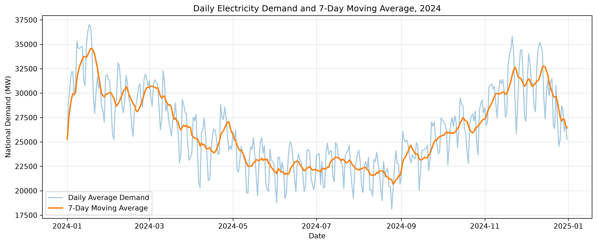
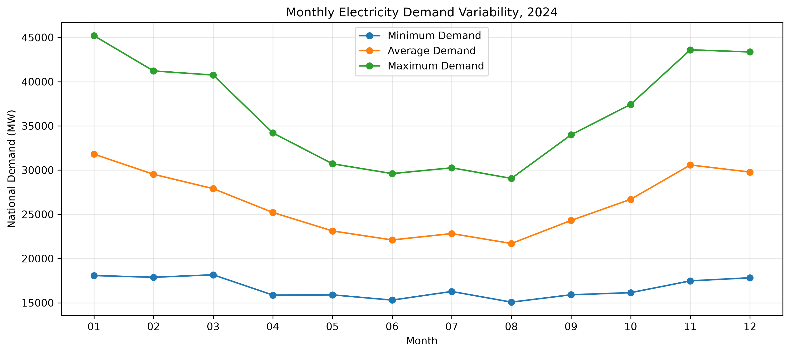

# UK Electricity Demand Analysis (2024)

## Project Overview

This project explores electricity demand patterns in Great Britain during 2024 using historical half-hourly electricity system data published by the National Energy System Operator (NESO).

The analysis investigates seasonal and daily demand patterns, differences between weekday and weekend electricity demand, peak demand periods, and the relationship between National Demand and embedded renewable generation.

Python and SQL are used for data cleaning, exploratory analysis, statistical summaries and visualisation.

The project demonstrates practical data analytics skills applied to electricity system data, with an emphasis on identifying trends and communicating meaningful insights.

## Key Questions

1. How does electricity demand vary throughout the year?
2. What are the typical daily electricity demand patterns?
3. How does electricity demand differ between weekdays and weekends?
4. How does demand vary across different seasons?
5. When do the highest and lowest demand periods occur?
6. What patterns can be observed in embedded wind and solar generation?
7. What relationships exist between National Demand and embedded renewable generation?
8. How can SQL window functions help identify broader demand trends?

## Tools and Technologies

- **Python:** Data processing and analysis
- **Pandas:** Data cleaning, feature engineering and aggregation
- **Matplotlib:** Data visualisation
- **SQL (SQLite):** Database queries, aggregation, CTEs and window functions
- **Jupyter Notebook:** Interactive analysis and documentation
- **Visual Studio Code:** Development environment

## Data Source

**National Energy System Operator (NESO) — Historic Demand Data (2024)**

The dataset contains 17,568 half-hourly electricity system records covering the 2024 calendar year.

Key variables include:

- National Demand (ND)
- Transmission System Demand (TSD)
- Embedded Wind Generation
- Embedded Solar Generation
- Settlement Date and Settlement Period

The analysis primarily focuses on National Demand and embedded renewable generation.

## Project Status

**Core analysis completed — documentation and portfolio preparation in progress.**

The project currently includes:

- Data exploration, validation and feature engineering
- Electricity demand pattern analysis
- Embedded renewable generation analysis
- SQL-based demand analysis
- SQL-powered visualisations

Further work focuses on documenting findings, organising outputs and preparing the project for publication on GitHub.

## Key Findings

### 1. Seasonal Electricity Demand

Electricity demand exhibited a clear seasonal pattern during 2024.

- **January** recorded the highest average monthly National Demand at approximately **31,809 MW**.
- **August** recorded the lowest average monthly National Demand at approximately **21,699 MW**.
- Average winter demand was approximately **30,389 MW**, compared with **22,210 MW** during summer.

These results demonstrate substantially higher electricity demand during the winter months.

### 2. Weekday vs Weekend Demand

Average National Demand differed noticeably between weekdays and weekends.

- **Weekday average:** 27,199 MW
- **Weekend average:** 23,988 MW
- **Difference:** Approximately 3,212 MW, representing an **11.8% reduction** at weekends.

This pattern is consistent with differences in commercial, industrial and other electricity consumption activities across the week.

### 3. Peak Electricity Demand

The highest half-hourly National Demand recorded during 2024 was **45,202 MW**, occurring on **15 January 2024**, during settlement period 36.

The highest demand observations were concentrated around the early evening, consistent with the daily demand profile.

This highlights the importance of examining peak demand alongside average demand when assessing electricity system requirements.

### 4. Embedded Renewable Generation

Embedded solar generation exhibited a pronounced daily cycle, with higher output around midday.

Embedded wind generation showed a less pronounced daily pattern.

Correlation analysis found:

- **National Demand vs Embedded Wind Generation:** r ≈ 0.052
- **National Demand vs Embedded Solar Generation:** r ≈ −0.132

These values indicate little linear association between National Demand and embedded wind generation, and a weak negative linear association with embedded solar generation.

The correlations are descriptive and should not be interpreted as evidence of causation.

### 5. Demand Trends and Variability

SQL-based analysis provided additional insights:

- A **7-day moving average** smoothed short-term demand fluctuations and highlighted broader seasonal trends.
- January recorded the widest monthly demand range, at **23,333 MW**.
- Average and maximum monthly demand did not always change proportionally, demonstrating the importance of analysing both typical and extreme demand levels.

## Visualisations

### Daily Electricity Demand and 7-Day Moving Average

The chart below compares daily average National Demand with its trailing 7-day moving average, highlighting short-term fluctuations and broader seasonal patterns.



### Monthly Electricity Demand Variability

This chart compares the minimum, average and maximum half-hourly National Demand recorded during each month of 2024.



## Project Structure

```text
uk-electricity-demand-analysis/
├── data/
│   ├── raw/
│   │   └── demanddata_2024.csv
│   └── electricity_demand.db
├── notebooks/
│   ├── 01_data_exploration.ipynb
│   ├── 02_demand_analysis.ipynb
│   ├── 03_renewable_analysis.ipynb
│   └── 04_sql_visualisations.ipynb
├── sql/
│   ├── 01_data_validation.sql
│   └── 02_demand_analysis.sql
├── src/
│   └── create_database.py
├── outputs/
│   ├── figures/
│   └── tables/
├── requirements.txt
├── .gitignore
└── README.md
```

## Getting Started

### 1. Clone the Repository

Clone this repository and navigate into the project directory:

```bash
git clone https://github.com/daniel-akih/uk-electricity-demand-analysis.git
cd uk-electricity-demand-analysis
```


### 2. Install Dependencies

Python 3 is required.

Install the required Python packages using:

```bash
python3 -m pip install -r requirements.txt
```

### 3. Obtain the Dataset

The analysis uses NESO's **Historic Demand Data for 2024**.

Download the dataset from the [NESO Data Portal](https://www.neso.energy/data-portal/historic-demand-data) and save it as:

`data/raw/demanddata_2024.csv`

### 4. Create the SQLite Database

From the project root directory, run:

```bash
python3 src/create_database.py
```

This script reads the original CSV file and creates a SQLite database at:

`data/electricity_demand.db`

### 5. Run the Analysis

Open the `notebooks` directory in VS Code or Jupyter and run the notebooks in the following order:

1. `01_data_exploration.ipynb` — Data validation, cleaning and feature engineering.
2. `02_demand_analysis.ipynb` — Seasonal, daily and weekday/weekend demand patterns.
3. `03_renewable_analysis.ipynb` — Embedded renewable generation patterns and correlations.
4. `04_sql_visualisations.ipynb` — SQL-based analysis and visualisations.

The SQL queries are also available separately in the `sql` directory.

### 6. Review the Outputs

Generated figures and tables are organised in the `outputs` directory.

The visualisations can also be viewed directly in this README.